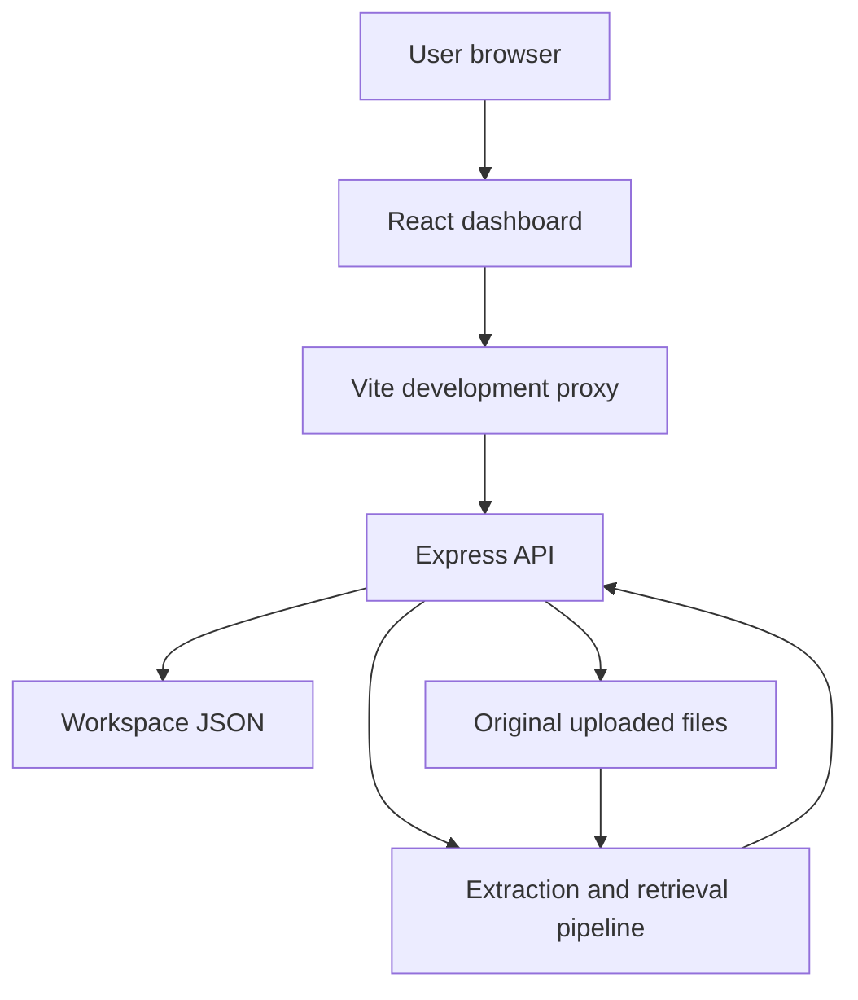

# High-Level Design: ResearchLens

## 1. Purpose and scope
ResearchLens is a personal document research workspace for PS 03, Intelligent Research & Knowledge Synthesis. The current prototype implements document ingestion, text extraction, lexical passage retrieval, and source inspection. It does not yet generate AI answers, comparisons, contradictions, evidence-gap assessments, or research reports.

This design describes the repository implementation reviewed on 22 October 2026. Planned capabilities are explicitly separated from existing behavior.

## 2. Architecture
The application is a React single-page interface connected to an Express API. The API owns one shared workspace in memory and persists it as JSON alongside original uploaded files. There is no database or external model service.

The Vite proxy is a development arrangement. A static frontend deployment needs a separately configured API and persistence arrangement to reproduce the local workflow.

## 3. Components

| Component | Source | Responsibility |
| --- | --- | --- |
| Dashboard | src/App.jsx | Uploads, question input, retrieval, activity, source drawer, document deletion |
| Presentation | src/styles.css | Layout, responsive styling, visual states |
| React entry | src/main.jsx | Mount the application |
| API and workspace | server/app.js | Validation, routes, persistence, processing queue, migration |
| Processing pipeline | server/pipeline.js | PDF/TXT extraction, passage creation, lexical ranking |
| Server entry | server/index.js | Start Express |
| Sample sources | samples/ | Three explicitly synthetic AI tutoring documents |
| Integration tests | server/app.test.js | Temporary-workspace API and processing checks |
| Development configuration | vite.config.js | React integration and API proxy |

## 4. Technology decisions
- React 18 and Vite 6 provide a fast client development workflow.
- Plain CSS and Lucide React provide the interface without a component framework.
- Express 4 provides HTTP routes; Multer 2 handles multipart disk uploads.
- Mozilla PDF.js extracts text from individual PDF pages.
- Node filesystem APIs store originals and metadata.
- Node's built-in test runner exercises the backend.
- package.json requires Node.js 22.13.0 or newer.
- No AI SDK, embeddings, vector database, authentication, or third-party document storage is implemented.

## 5. Principal flows
### Document ingestion
The user uploads PDF or UTF-8 TXT files. Multer validates extensions and upload limits and writes files under generated names. The API reserves workspace slots, persists processing metadata, and queues extraction. Extracted text becomes overlapping passages. Success updates the document to ready; extraction failure updates it to error and provides a user-facing explanation. The client polls while documents are processing.

### Retrieval
The user enters a question and selects Find passages. The API searches passages from ready documents using normalized query terms and BM25-style weighting. It returns at most eight matching passages, with adjustments for source diversity and overlap. The user can inspect their exact stored text and source references. A lack of matching terms returns an empty result, not an inferred answer.

### Source inspection and deletion
The evidence drawer displays PDF page references or TXT paragraph ranges, with previous/next passage navigation and original-file download. Deletion removes a completed document, its original file, and its passages, then clears retrieval results. Processing documents cannot be deleted until processing finishes.

## 6. Persistence and consistency
The default data directory contains workspace.json and uploads/. RESEARCHLENS_DATA_DIR can override the location. Workspace version 2 contains documents, passages, question, latest results, and activity.

Writes are serialized within one process. Each snapshot is written to a temporary file and renamed into place. Processing is also queued within the process. Startup migrates older workspace metadata and resumes interrupted processing from preserved originals. Normal restarts preserve existing passage IDs but clear previous retrieval results.

This is not a transactional database or a multi-process storage design. Independent server instances must not share these files without further coordination.

## 7. Limits and security boundaries
- Maximum eight documents, including documents with extraction errors.
- Maximum 10 MiB per file and 4,000 characters per research question.
- JSON request bodies limited to 64 KB.
- Display names sanitized; stored upload filenames generated using UUIDs.
- API responses omit internal storage names and full extraction units.
- The server permits browser Origin values for configured localhost development ports; this is not authentication.
- The prototype has no user isolation, accounts, encryption layer, or public-hosting access controls.
- The current local workflow sends no document text to an AI provider.
- Data lives on the server filesystem, which is the user's computer only in the local setup.

## 8. Deployment
Use npm install and npm run dev for the intended local workflow. Vite runs on 127.0.0.1:5173; Express defaults to port 3001. npm run build generates frontend assets only.

The published frontend URL does not by itself establish that the backend is deployed or functional. The current backend requires a running Node process, writable persistent storage, and compatible origin/proxy settings. Public deployment requires explicit decisions for access control, API routing, and durable storage.

## 9. Future architecture
Planned extensions include objective decomposition, model-assisted synthesis over retrieved passages, claim-level citation checking, comparison and contradiction analysis, evidence gaps, report export, and saved research sessions. Public multi-user operation would additionally require authentication, per-user isolation, durable database/object storage, and resource controls.

## 10. Validation
The existing test suite covers core ingestion, extraction, references, limits, retrieval diversity, restarts, downloads, deletion, and synthetic labels. Documentation was checked against source; no runtime test result is claimed by this document. Commands: npm test and npm run build.
